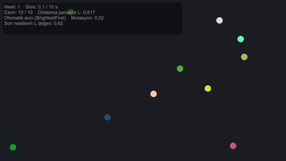
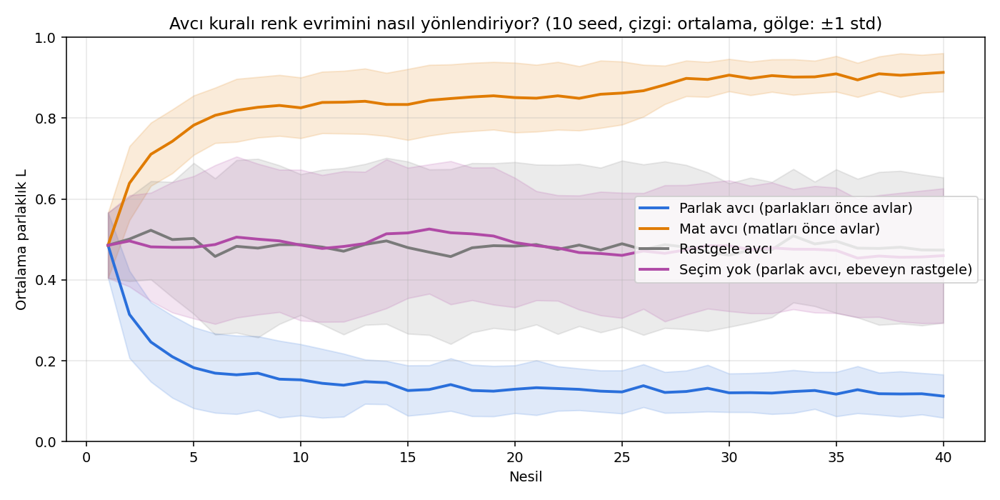
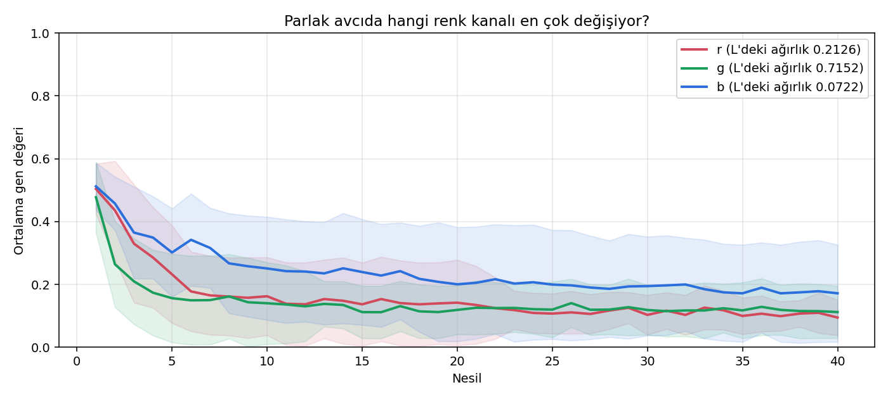
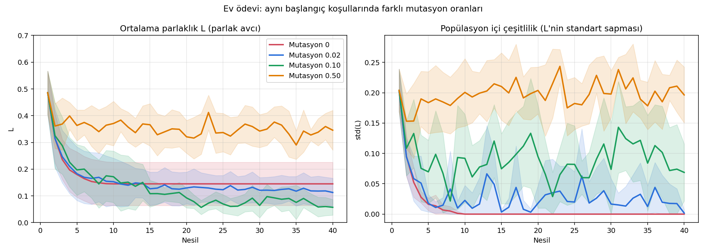
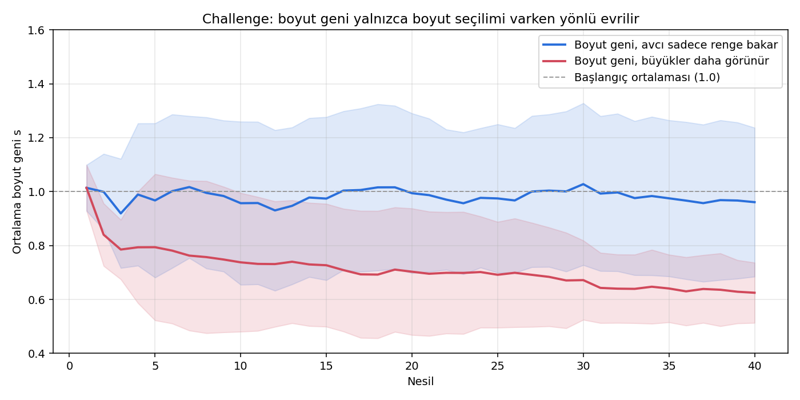

# Rapor 5 (Hafta 6): Genetik Algoritma ile Kamuflaj Evrimi

BLM5026 Bilgisayar Oyunlarında Yapay Zeka · Veysel Uğurlu · Unity 6.3 LTS (6000.3.25f1) · Universal 2D · Input System 1.20



*Otomatik avcı her nesilde en parlak bireyleri önce yakalıyor. 13 nesil içinde popülasyonun ortalama parlaklığı 0.62'den 0.07'ye iniyor ve bireyler koyu zemine karışıyor.*

---

## 1. Bu hafta ne yaptık?

Ekranda renkli daireler (bireyler) var. Bir avcı, ister fareyle oynayan kişi ister bilgisayar, onları tek tek yakalıyor. Avcıdan en uzun kaçan bireyler bir sonraki neslin ebeveynleri oluyor, çocuklar da renklerini onlardan miras alıyor. Bu döngü nesiller boyu tekrarlandığında, avcının kolay gördüğü renkler popülasyondan kayboluyor ve zemine uyan renkler çoğalıyor. Kimse "koyu renk ol" diye bir kural yazmıyor; kamuflajı seçilim, çaprazlama ve mutasyon ortaya çıkarıyor.

| Ne | Sonuç |
|---|---|
| Sunudaki 9 etkinlik | Hepsi uygulandı (tablo: bölüm 4) |
| Kontrollü deney (slayt 35) | Parlak avcı: L 0.486 → 0.113. Mat avcı: L 0.486 → 0.913 (40 nesil, 10 seed) |
| Kontroller (slayt 36) | Rastgele avcı ve seçimsiz koşulda yönlü değişim yok (L ≈ 0.47) |
| Ev ödevi: mutasyon oranları | 0 → popülasyon tek renge kilitleniyor; 0.10 → en koyu sonuç (L 0.057); 0.50 → seçilim zayıflıyor (L 0.346) |
| Challenge: boyut geni | Avcı yalnızca renge bakarken boyut yönsüz (s 0.96 ± 0.29); büyükler daha görünür olunca bireyler küçülüyor (s 0.63) |

## 2. Temel kavramlar

| Kavram | Bu projedeki karşılığı |
|---|---|
| Birey | Ekrandaki bir daire (`Person` prefab'ı, `DNA.cs`) |
| Kromozom / genotip | `[r, g, b]` üç sayı (0 ile 1 arası); challenge'da 4. gen `s` (boyut) |
| Fenotip | Genlerin görünen hali: dairenin rengi (`SpriteRenderer.color`) ve büyüklüğü |
| Fitness (uygunluk) | Hayatta kalma süresi; hiç yakalanmayan birey nesil süresinin tamamını (10 s) alır |
| Seçilim | Fitness'a göre sıralayıp en iyi %50'yi ebeveyn havuzu yapmak |
| Çaprazlama (uniform crossover) | Her gen, anneden ya da babadan %50 olasılıkla ayrı ayrı alınır |
| Mutasyon | Her gen, düşük bir olasılıkla (0.02) tamamen yeni rastgele bir değerle değişir |
| Nesil | 10 saniyelik bir tur; sonunda eski bireyler silinir, 10 çocuk doğar |
| Parlaklık L | `L = 0.2126r + 0.7152g + 0.0722b` (insan gözü yeşile en duyarlı) |

**GA ve GP farkı (slayt 3, 39):** Bu çalışma bir **genetik algoritmadır**: evrimleşen şey sabit uzunlukta bir sayı dizisidir (renk genleri). Genetik programlamada ise evrimleşen şey bir programdır, örneğin `if (enemyNear) hide();` gibi bir karar ağacı. İki yöntemin evrim mekanizması aynıdır; farkları neyin evrimleştiğidir.

## 3. Sahne ve mimari

```
CamouflageScene
├── Main Camera          Orthographic, Size 5, (0, 0, -10), koyu zemin rengi
├── PopulationManager    PopulationManager.cs (+ DemoRecorder.cs)
└── (Play sırasında) Person(Clone) × 10

Assets
├── Scripts/Genome.cs             kromozom ve parlaklık L
├── Scripts/DNA.cs                birey: Initialize, Kill, FinishGeneration
├── Scripts/GeneticAlgorithm.cs   seçilim, çaprazlama, mutasyon, otomatik avcı
├── Scripts/PopulationManager.cs  nesil döngüsü, fare ile av, ekran bilgisi
├── Scripts/Editor/               sahne kurucu, deney koşucu, rapor görüntüleri
└── Prefabs/Person.prefab         SpriteRenderer + CircleCollider2D + DNA, ölçek 0.4
```

Sunudaki "tek sorumluluk" ilkesi (slayt 15) korundu: `DNA` yalnızca bireyin durumunu tutar, tıklamayı ve evrim döngüsünü `PopulationManager` yönetir. Seçilim, çaprazlama ve mutasyon ayrı bir `GeneticAlgorithm` sınıfında; hem canlı sahne hem de toplu deneyler aynı kodu çağırıyor.

Sunu yalnızca C# dosyaları içerdiği için sahne ve prefab'ı elle kurmak yerine bir editor scripti yazıldı: Unity menüsünde **Genetik Algoritma → 1. Sahneyi ve Prefab'ı Kur**.

## 4. Sunudaki etkinlikler

| Etkinlik | Ne istendi | Nerede |
|---|---|---|
| 1. Fitness tasarımı | Sayısal fitness ve yönü | `DNA.SurvivalTime`: büyük olan iyi |
| 2. Person prefab | SpriteRenderer + CircleCollider2D | `Prefabs/Person.prefab` |
| 3. DNA yapısı | r, g, b ∈ [0,1], `Initialize` ile renk | `DNA.Initialize(Genome)` |
| 4. Avcı tıklaması | Fare ile bireyi bul, öldür, iki kez avlanmasın | `PopulationManager.HandleClick`, `DNA.Kill` |
| 5. Hata avcılığı | Hiç tıklanmayan bireyin fitness'ı | `DNA.FinishGeneration(T)` → 10 s |
| 6. Yeni neslin boyutu | Tam N = 10 çocuk | `GeneticAlgorithm.NextGeneration` |
| 7. Crossover | Genler bağımsız %50 | `GeneticAlgorithm.InheritOrMutate` |
| 8. Mutasyon | Gen başına `mutationRate` | `GeneticAlgorithm.InheritOrMutate` |
| 9. Challenge | 4. gen `s`: boyut | `Genome.s`, `DNA.Initialize`, `Breed` |

### Fare ile av (Etkinlik 4)

```csharp
if (Mouse.current == null || !Mouse.current.leftButton.wasPressedThisFrame) return;
Vector2 p = Mouse.current.position.ReadValue();
Vector3 world = sceneCamera.ScreenToWorldPoint(new Vector3(p.x, p.y, -sceneCamera.transform.position.z));
Collider2D hit = Physics2D.OverlapPoint((Vector2)world);
if (hit != null && hit.TryGetComponent(out DNA target))
    target.Kill(elapsed);
```

Fare konumu piksel cinsindendir, bireyler ise dünya biriminde durur. `ScreenToWorldPoint` bu dönüşümü yapar; ardından `OverlapPoint` o noktadaki collider'ı bulur. Eski `OnMouseDown` yerine yeni Input System kullanıldı.

### Hayatta kalanın fitness'ı (Etkinlik 5)

Sunudaki eski kodda `timeToDie = 0` ile başlanıp yalnızca avlananlar güncelleniyordu. Bu durumda hiç yakalanmayan, yani en iyi birey 0 puan alır ve sıralamada en sona düşer. Düzeltme:

```csharp
public void FinishGeneration(float duration)
{
    if (!IsDead) SurvivalTime = duration; // 10 s'lik nesilde sağ kalan = 10
}
```

### Yeni nesil (Etkinlik 6-8)

```csharp
List<int> ranked = Enumerable.Range(0, genomes.Count)
    .OrderBy(_ => Random.value)              // eşit fitness'lar rastgele sıralansın
    .OrderByDescending(i => fitness[i])      // kararlı sıralama: en uzun yaşayan önde
    .ToList();
int k = Mathf.Clamp(Mathf.CeilToInt(populationSize * selectedFraction), 2, ranked.Count);
for (int i = 0; i < populationSize; i++)     // ebeveyn sayısından bağımsız, tam N çocuk
    children.Add(Breed(genomes[ranked[Random.Range(0, k)]], genomes[ranked[Random.Range(0, k)]], settings));
```

```csharp
public static float InheritOrMutate(float mother, float father, float mutationRate)
{
    float inherited = Random.value < 0.5f ? mother : father;
    if (Random.value < mutationRate) return Random.value;
    return inherited;
}
```

Önce çocukların genomları hesaplanır, eski nesil ancak bundan sonra `Destroy` edilir; böylece silinmiş nesneye erişme hatası olmaz.

## 5. Kontrollü deneyler

Sunudaki uyarıya uyuldu: "tek bir gözlem bilimsel bir sonuca eşdeğer değildir." Her koşul 40 nesil boyunca, **aynı 10 seed** ile ayrı ayrı çalıştırıldı. Aynı seed aynı başlangıç popülasyonunu verdiği için koşullar arasındaki tek fark incelenen ayardır. Ortak ayarlar: N = 10, nesil süresi 10 s, ebeveyn oranı 0.5, otomatik avcı her 1.5 s'de bir birey yakalar (nesil başına 6 av, 4 hayatta kalan).

Deneyler kare kare oynatılmadan, aynı `GeneticAlgorithm` koduyla hesaplandı ([ExperimentRunner.cs](../../Assets/Scripts/Editor/ExperimentRunner.cs)). Ham veri: [data/generations.csv](data/generations.csv), özet: [data/summary.json](data/summary.json).

### 5.1 Avcı kuralı (slayt 35-36)



| Koşul | 1. nesil L | 10. nesil L | 40. nesil L |
|---|---|---|---|
| Parlak avcı | 0.486 ± 0.085 | 0.153 ± 0.093 | 0.113 ± 0.056 |
| Mat avcı | 0.486 ± 0.085 | 0.826 ± 0.079 | 0.913 ± 0.050 |
| Rastgele avcı | 0.486 ± 0.085 | 0.487 ± 0.183 | 0.474 ± 0.189 |
| Seçim yok (parlak avcı, ebeveyn rastgele) | 0.486 ± 0.085 | 0.486 ± 0.197 | 0.460 ± 0.175 |

*Değerler 10 seed'in ortalaması ± standart sapması.*

İki hipotez de doğrulandı: parlakları önce avlayan avcı popülasyonu koyulaştırıyor, matları önce avlayan avcı açıyor. Rastgele avcıda ve seçimin kapatıldığı kontrolde ortalama yerinde sayıyor; yani yönlü değişimin sebebi avcının renge göre seçmesi ve uzun yaşayanların ebeveyn olması. Bu iki kontrolde seed'ler arası sapmanın büyük olması (± 0.18), küçük popülasyonda rastgele sürüklenmenin (genetik sürüklenme) etkisini gösteriyor.



Parlak avcıda en hızlı düşen kanal yeşil (g). Parlaklık formülünde yeşilin ağırlığı en büyük (0.7152) olduğu için, yeşili düşük bireyler en az görünür olanlar. Mavi kanal (ağırlık 0.0722) en yavaş değişiyor.

### 5.2 Ev ödevi: farklı mutasyon oranları



| Mutasyon oranı | 40. nesil L | 40. nesilde çeşitlilik std(L) |
|---|---|---|
| 0 | 0.145 ± 0.085 | 0.000 |
| 0.02 | 0.113 ± 0.056 | 0.002 |
| 0.10 | 0.057 ± 0.031 | 0.069 |
| 0.50 | 0.346 ± 0.078 | 0.196 |

- **Mutasyon 0:** Çaprazlama yeni değer üretmez, yalnızca ilk nesildeki genleri karıştırır. Seed'e göre 5. ile 10. nesil arasında bütün bireyler aynı renge kilitleniyor (çeşitlilik tam 0) ve evrim duruyor. Ulaşılan renk, ilk nesilde şans eseri bulunan en koyu genlerle sınırlı.
- **Mutasyon 0.02 (ders değeri):** Yavaş ama sürekli iyileşme.
- **Mutasyon 0.10:** Bu ayarlarda en koyu sonuç. Yeni değerler daha sık denendiği için daha koyu renkler bulunuyor; seçilim de kötü mutasyonları hemen eliyor.
- **Mutasyon 0.50:** Genlerin yarısı her nesilde rastgele değiştiği için seçilimin kazandırdığı kayboluyor. Sunudaki %50 örneğinin ders demosunu bozmasının sebebi bu.

### 5.3 Challenge: boyut geni



| Koşul | 40. nesil boyut s |
|---|---|
| Avcı yalnızca parlaklığa bakar | 0.961 ± 0.291 |
| Büyük bireyler daha görünür (görünürlük = L × s) | 0.625 ± 0.118 |

Sunudaki soru: "Görünürlük yalnız renge bağlıysa büyüklük geni evrilir mi?" Hayır. Avcı yalnızca renge baktığında boyutun hayatta kalmaya etkisi yok; boyut ortalaması 1.0 çevresinde kalıyor, her seed'de rastgele bir yöne kayıyor (sapma ± 0.29). Görünürlüğe boyut da katıldığında küçük bireyler daha geç yakalanıyor ve popülasyon belirgin biçimde küçülüyor. Bir gen ancak hayatta kalmayı etkiliyorsa yönlü evrilir.

## 6. Ne iddia edemeyiz? (slayt 36)

- "Mükemmel kamuflaj oluştu" diyemeyiz: avcının algısı yalnızca parlaklık sıralaması; gerçek bir göz modeli, zemin dokusu veya renk kontrastı yok.
- "Her nesilde mutlaka daha iyi olur" diyemeyiz: parlak avcı deneyinde, nesilden nesle geçişlerin 105/390'ında (%27) ortalama parlaklık bir önceki nesle göre arttı (mutasyon ve küçük popülasyon).
- Sonuçlar bu ayarlara (N = 10, 6 av/nesil, %50 ebeveyn) bağlı; örneğin en iyi mutasyon oranı başka ayarlarda değişebilir.

## 7. Çıkış bileti (slayt 40)

1. **RGB vektörü genotip mi fenotip mi?** Genotip. Ekranda görünen renk ise fenotiptir.
2. **Hiç tıklanmayan bireyin 10 s sonundaki fitness'ı?** 10 (nesil süresinin tamamı).
3. **Mutasyon sıfırken crossover yeni bir gen değeri yaratabilir mi?** Hayır; yalnızca ebeveynlerin mevcut değerlerinden seçer. Deneyde mutasyon 0 iken çeşitlilik tam 0'a iniyor.
4. **Bu örnek GA mı GP mi?** Genetik algoritma: evrimleşen şey sabit uzunluklu bir sayı dizisi, bir program değil.

## 8. Çalıştırma

1. Unity Hub → Add project from disk → depo klasörü (Unity 6000.3.x).
2. `Assets/Scenes/CamouflageScene.unity` sahnesini aç, **Play**'e bas, parlak gördüğün bireylere tıkla.
3. Otomatik avcı için `PopulationManager` → **Automatic Hunter** kutusunu işaretle; kural `Settings → Hunter Rule`.
4. Deneyleri tekrar üretmek için: **Genetik Algoritma → 2. Deneyleri Çalıştır**, ardından `python tools/plot_experiments.py`.

## 9. Kaynaklar

- Ders sunusu: *Genetik Algoritmalar: Unity ile Kamuflajın Evrimi* (Unity 6.3), BLM5026, 2026.
- J. H. Holland, *Adaptation in Natural and Artificial Systems*, MIT Press, 1992.
- D. E. Goldberg, *Genetic Algorithms in Search, Optimization, and Machine Learning*, Addison-Wesley, 1989.
- M. Mitchell, *An Introduction to Genetic Algorithms*, MIT Press, 1998.
- I. Millington, *AI for Games*, 3. baskı, CRC Press, 2019.
- ITU-R BT.709 (parlaklık katsayıları).
